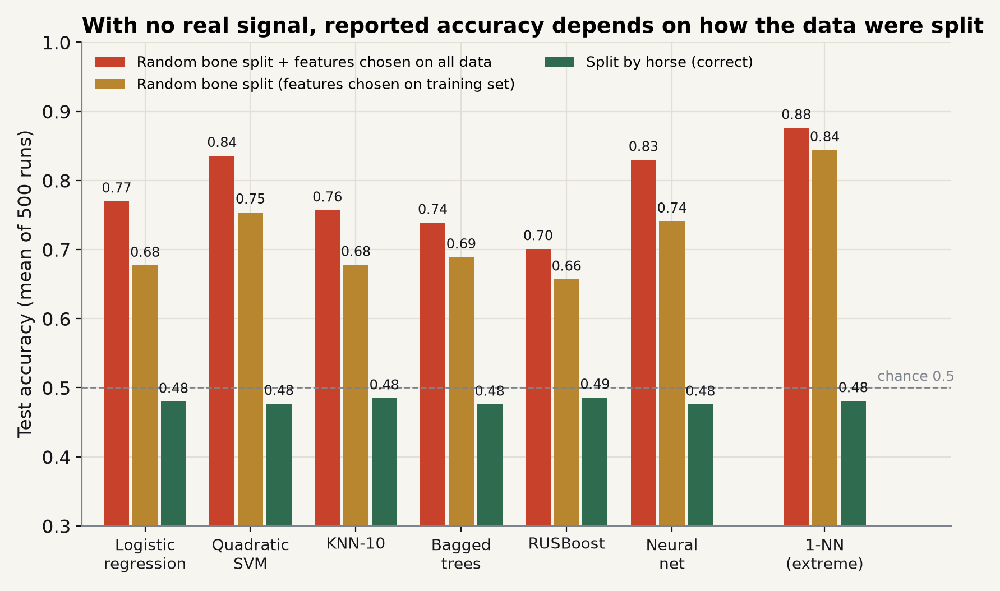
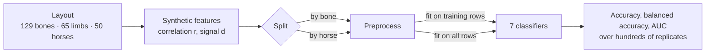

<div align="center">

# horsefold

How much does a racehorse fracture model's accuracy inflate when bones, not horses, are split into folds? A Monte Carlo study on the sample layout of Basran et al. (2022).

[Method](docs/method.md) · [Results](docs/results.md) · [Architecture](docs/architecture.md) · [Issues](https://github.com/naritaroad/horsefold/issues)

[](https://github.com/naritaroad/horsefold/actions/workflows/ci.yml)
[](LICENSE)
[](pyproject.toml)

**English** | [繁體中文](README.zh-TW.md)

</div>

Basran et al. (2022) trained classifiers on μCT radiomic features of 129 proximal sesamoid bones from 50 Thoroughbred racehorses, two bones per limb and up to four per horse. If bones are split at random, most test bones have a sibling from the same horse in training, and a model can score well by recognising the horse rather than the fracture. Selecting features on all bones before splitting has a similar effect. The paper does not state how it handled either. horsefold builds synthetic data with the same 129-bone, 65-limb, 50-horse layout, sets the true signal to zero or to a known strength, and measures what each validation choice reports. It does not claim the paper leaked; it shows the size of the effect if it had.

The name is the fix: cross-validation folds by horse (scikit-learn's `GroupKFold` with the horse as the group). Both problems are described in the literature (Saeb et al., 2017; Kapoor & Narayanan, 2023), and the same code works for any layout where one subject contributes several samples, such as several scans per patient.

## Features

- Three-level layouts (group → cluster → unit) from a list of counts; the Basran et al. (2022) layout is built in and checked against the paper's totals.
- Features with set within-limb and within-horse correlation and an optional true signal on chosen features.
- Two split strategies (by unit, by group) and two preprocessing modes (fitted on training rows, or on all rows) across seven classifiers configured after the paper.
- Closed-form leak rate of a random unit split, checked by simulation.
- Six experiments: main comparison, correlation sweep with a negative control, signal sweep, sensitivity analysis, 10-fold cross-validation, and the optimism of reporting the best of 24 configurations.
- Seeds derived per scenario, so results do not depend on the number of workers.
- Figures in English and Traditional Chinese.

## Results

With no real signal (features unrelated to fracture), 500 replicates, within-limb correlation 0.7:



| Validation | Accuracy, six paper models |
|---|---|
| Split by horse, features selected on training data (correct) | 0.48 for every model |
| Random bone split | 0.66–0.75 |
| Random bone split, features selected on all 129 bones | 0.70–0.84 |
| Split by horse, features selected on all 129 bones | 0.58–0.71 |

- 82.6% of test bones in a random 90/39 split have a bone from the same horse in training (closed form and simulation agree).
- The inflation grows with within-horse correlation and vanishes at zero correlation, the negative control.
- 10-fold CV with bone-level folds inflates as much as a single bone split.
- Reporting the best of 24 configurations adds about 0.09 even with correct splitting.

All tables, the signal and correlation sweeps, and the sensitivity analysis are in [docs/results.md](docs/results.md).

## How it works



Each replicate draws a new feature matrix and a new split. Because the true signal is set by hand, the gap between a validation scheme's accuracy and the grouped, clean one is the inflation that scheme adds. The generative model, the pipeline and the experiment list are in [docs/method.md](docs/method.md); module layout and design decisions are in [docs/architecture.md](docs/architecture.md).

<details>
<summary>Technical details</summary>

- **Features:** each feature is horse effect + limb effect + bone noise, with total variance 1. Same-limb bones correlate at *r* (0.7 in the main analysis), same-horse bones in different limbs at 5*r*/7.
- **Pipeline:** top 20 of 102 features by Welch *t*, z-scoring, then logistic regression, quadratic SVM, KNN-10, bagged trees, RUSBoost, a 25-unit neural network, and 1-NN as an extreme case.
- **Reproducibility:** replicate seeds come from `SeedSequence([20261102, crc32(scenario tag)])`. `uv.lock` pins the library versions, and the results JSON records them.
- **Run time:** the full suite makes about 176,000 model fits. On an AMD Ryzen 9 5900X (24 threads) it takes about 7.5 minutes; `--quick` uses 4% of the replicates.

</details>

## Installation

Requires Python 3.12 or newer. With [uv](https://docs.astral.sh/uv/):

```bash
git clone https://github.com/naritaroad/horsefold.git
cd horsefold
uv sync
```

Or with pip, in a virtual environment: `pip install -e ".[plot]"`.

## Usage

```bash
uv run horsefold leak-rate                       # exact vs simulated leak rate of a random 90/39 bone split
uv run horsefold run --quick --out quick.json    # smoke run with 4% of the replicates
uv run horsefold run                             # full suite → results/basran2022.json + .log
uv run horsefold plot                            # figures → docs/assets/
uv run horsefold plot --lang zh-TW               # Traditional Chinese labels (needs a CJK font such as Noto Sans TC)
```

From Python, for another layout:

```python
from horsefold import Design, Structure, run

# 40 patients: 20 cases with 3 scans each, 20 controls with 2; one cluster per patient
s = Structure.from_groups([(1, [3])] * 20 + [(0, [2])] * 20, names=("patient", "visit", "scan"))
res = run("my layout", 200, s, Design(r=0.8, n_test=25, p=50, n_select=10))
print(res["unit|clean|LR"]["acc"], res["group|clean|LR"]["acc"])
```

## Project structure

```
horsefold/
├── src/horsefold/      # structure, data, splits, pipeline, experiments, plots, cli
├── tests/              # pytest suite (about two minutes)
├── results/            # basran2022.json from the full run
├── docs/               # method, results, architecture; zh-TW/ translations; assets/ figures
├── .github/workflows/  # CI: ruff, pytest, quick end-to-end run
├── pyproject.toml
└── uv.lock
```

## Contributing

Issues and pull requests are welcome. Setup, tests and the rule for keeping results and figures in sync with the code are in [CONTRIBUTING.md](CONTRIBUTING.md).

## License

[MIT](LICENSE). To cite, see [CITATION.cff](CITATION.cff).

## References

- Basran, P. S., McDonough, S., Palmer, S., & Reesink, H. L. (2022). Radiomics modeling of catastrophic proximal sesamoid bone fractures in Thoroughbred racehorses using μCT. *Animals, 12*(21), 3033. https://doi.org/10.3390/ani12213033
- Kapoor, S., & Narayanan, A. (2023). Leakage and the reproducibility crisis in machine-learning-based science. *Patterns, 4*(9), 100804. https://doi.org/10.1016/j.patter.2023.100804
- Saeb, S., Lonini, L., Jayaraman, A., Mohr, D. C., & Kording, K. P. (2017). The need to approximate the use-case in clinical machine learning. *GigaScience, 6*(5), gix019. https://doi.org/10.1093/gigascience/gix019

More in [docs/method.md](docs/method.md#references).
