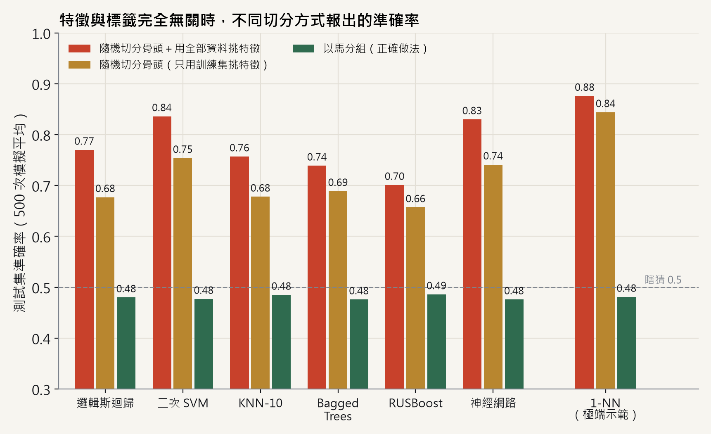
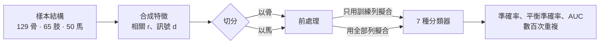

<div align="center">

# horsefold

賽馬骨折預測模型若以骨頭而非以馬分折，準確率會虛增多少？以 Basran et al. (2022) 的樣本結構做的蒙地卡羅模擬。

[方法](docs/zh-TW/method.md) · [結果](docs/zh-TW/results.md) · [架構](docs/architecture.md) · [問題回報](https://github.com/naritaroad/horsefold/issues)

[](https://github.com/naritaroad/horsefold/actions/workflows/ci.yml)
[](LICENSE)
[](pyproject.toml)

[English](README.md) | **繁體中文**

</div>

Basran et al. (2022) 用 50 匹純種賽馬、129 塊近端籽骨的 μCT 影像組學特徵訓練分類器；每肢兩塊骨，每匹馬最多四塊。如果隨機切分骨頭，大部分測試骨在訓練集裡都有同一匹馬的「手足」，模型可以靠認出是哪匹馬而不是認出骨折來得到高分。切分前用全部骨頭挑特徵也有類似效果。論文沒有說明這兩件事怎麼處理。horsefold 依同樣的 129 骨、65 肢、50 馬結構產生合成資料，把真訊號設成零或已知強度，再量測每一種驗證方式報出的數字。本專案不主張原論文有洩漏，只呈現「如果有」的影響幅度。

名稱就是解法：以馬為單位分折做交叉驗證（scikit-learn 的 `GroupKFold`，以馬為組）。這兩個問題文獻早有討論（Saeb et al., 2017；Kapoor & Narayanan, 2023）；同一套程式也適用於其他「一個個體貢獻多個樣本」的資料，例如一位病人多張影像。

## 功能

- 由各層數量建立三層結構（組 → 簇 → 樣本）；內建 Basran et al. (2022) 的結構，並與論文的總數核對。
- 產生可設定同肢、同馬相關的特徵，並可在指定特徵上加入真訊號。
- 兩種切分（以樣本、以組）與兩種前處理（只用訓練列擬合、用全部列擬合），搭配七種依論文設定的分類器。
- 隨機切分樣本時洩漏率的解析解，並以模擬驗證。
- 六組實驗：主比較、含陰性對照的相關掃描、訊號強度掃描、敏感度分析、10 折交叉驗證、從 24 組設定挑最高分的樂觀偏差。
- 每個情境各自衍生亂數種子，結果不受平行工作數影響。
- 圖表有英文與繁體中文兩種版本。

## 結果

沒有真訊號（特徵與骨折無關）、500 次重複、同肢相關 0.7 時：



| 驗證方式 | 論文六個模型的準確率 |
|---|---|
| 以馬分組，只用訓練資料挑特徵（正確） | 每個模型都是 0.48 |
| 隨機切分骨頭 | 0.66–0.75 |
| 隨機切分骨頭，用全部 129 塊骨挑特徵 | 0.70–0.84 |
| 以馬分組，用全部 129 塊骨挑特徵 | 0.58–0.71 |

- 90／39 隨機切分時，82.6% 的測試骨在訓練集中有同馬的骨頭（解析解與模擬一致）。
- 同馬相關越高，高估越大；相關為零（陰性對照）時差距消失。
- 以骨頭分折的 10 折交叉驗證，高估幅度和單次骨頭切分一樣大。
- 即使切分正確，從 24 組設定中只報最高的一組也會多出約 0.09。

完整表格、訊號強度與相關掃描、敏感度分析見 [docs/zh-TW/results.md](docs/zh-TW/results.md)。

## 運作方式



每次重複都重新產生特徵並重新切分。因為真訊號是人為設定的，某種驗證方式的準確率與「以馬分組、乾淨前處理」之間的差距，就是該方式帶來的高估。生成模型、流程與實驗清單見 [docs/zh-TW/method.md](docs/zh-TW/method.md)；模組與設計決策見 [docs/architecture.md](docs/architecture.md)（英文）。

<details>
<summary>技術細節</summary>

- **特徵：** 每個特徵 = 馬匹效果 + 肢體效果 + 骨頭雜訊，總變異數為 1。同肢兩塊骨相關為 *r*（主分析 0.7），同馬不同肢為 5*r*/7。
- **流程：** 以 Welch *t* 從 102 個特徵挑前 20 個、z 分數標準化，再訓練邏輯斯迴歸、二次 SVM、KNN-10、Bagged Trees、RUSBoost、25 節點神經網路，另加 1-NN 作極端示範。
- **可重現：** 每次重複的種子來自 `SeedSequence([20261102, crc32(情境標籤)])`。`uv.lock` 鎖定套件版本，結果 JSON 也記錄版本。
- **執行時間：** 完整實驗約擬合 176,000 次模型。在 AMD Ryzen 9 5900X（24 執行緒）上約 7.5 分鐘；`--quick` 只跑 4% 的重複次數。

</details>

## 安裝

需要 Python 3.12 以上。使用 [uv](https://docs.astral.sh/uv/)：

```bash
git clone https://github.com/naritaroad/horsefold.git
cd horsefold
uv sync
```

或在虛擬環境中用 pip：`pip install -e ".[plot]"`。

## 使用方式

```bash
uv run horsefold leak-rate                       # 90/39 隨機切分骨頭的洩漏率：解析解 vs 模擬
uv run horsefold run --quick --out quick.json    # 只跑 4% 重複次數的快速檢查
uv run horsefold run                             # 完整實驗 → results/basran2022.json 與 .log
uv run horsefold plot                            # 圖表 → docs/assets/
uv run horsefold plot --lang zh-TW               # 中文標籤（需要 Noto Sans TC 等中文字型）
```

在 Python 中套用其他結構：

```python
from horsefold import Design, Structure, run

# 40 位病人：20 位病例各 3 張影像、20 位對照各 2 張；每位病人一個簇
s = Structure.from_groups([(1, [3])] * 20 + [(0, [2])] * 20, names=("patient", "visit", "scan"))
res = run("my layout", 200, s, Design(r=0.8, n_test=25, p=50, n_select=10))
print(res["unit|clean|LR"]["acc"], res["group|clean|LR"]["acc"])
```

## 專案結構

```
horsefold/
├── src/horsefold/      # structure、data、splits、pipeline、experiments、plots、cli
├── tests/              # pytest 測試（約兩分鐘）
├── results/            # 完整執行的 basran2022.json
├── docs/               # 方法、結果、架構；zh-TW/ 中文版；assets/ 圖表
├── .github/workflows/  # CI：ruff、pytest、快速端對端執行
├── pyproject.toml
└── uv.lock
```

## 參與貢獻

歡迎提出 issue 與 pull request。環境設定、測試，以及結果與圖表要與程式碼同步的規則，見 [CONTRIBUTING.md](CONTRIBUTING.md)（英文）。

## 授權

[MIT](LICENSE)。引用方式見 [CITATION.cff](CITATION.cff)。

## 參考文獻

- Basran, P. S., McDonough, S., Palmer, S., & Reesink, H. L. (2022). Radiomics modeling of catastrophic proximal sesamoid bone fractures in Thoroughbred racehorses using μCT. *Animals, 12*(21), 3033. https://doi.org/10.3390/ani12213033
- Kapoor, S., & Narayanan, A. (2023). Leakage and the reproducibility crisis in machine-learning-based science. *Patterns, 4*(9), 100804. https://doi.org/10.1016/j.patter.2023.100804
- Saeb, S., Lonini, L., Jayaraman, A., Mohr, D. C., & Kording, K. P. (2017). The need to approximate the use-case in clinical machine learning. *GigaScience, 6*(5), gix019. https://doi.org/10.1093/gigascience/gix019

完整清單見 [docs/method.md](docs/method.md#references)。
