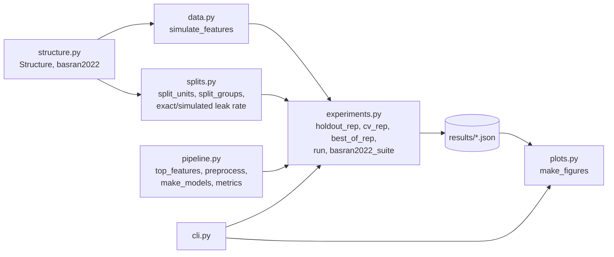

# Architecture

## Modules

- `structure.py` describes the three-level layout (group → cluster → unit) as index arrays. `basran2022()` is the only built-in layout; `Structure.from_groups` builds any other.
- `data.py` draws features with known group- and cluster-level correlation and an optional true signal.
- `splits.py` holds the two split strategies and the leak rate of the unit-level split, in closed form and by simulation.
- `pipeline.py` holds feature selection, scaling, the seven classifiers and the metrics. `preprocess(..., ref)` fits selection and scaling on rows `ref` only; passing all rows is the leaky variant.
- `experiments.py` runs replicates in parallel with joblib and summarises them. `basran2022_suite` defines E1–E6.
- `plots.py` reads a results JSON and draws F1–F3 in English or Traditional Chinese.

## Reproducibility

Each scenario has a tag (for example `E1 d=0.0`). Replicate seeds come from `numpy.random.SeedSequence([20261102, crc32(tag)])`, so a scenario returns the same numbers whatever the worker count and whichever other scenarios run. `tests/test_experiments.py` checks `n_jobs=1` against `n_jobs=2`.

Numbers can still shift slightly across library versions (for example the MLP and bagging implementations in scikit-learn). `uv.lock` pins the versions used for `results/basran2022.json`, and the JSON records them under `meta.versions`.

## Decisions

### Python version (checked 2026-11-02)

`requires-python = ">=3.12"`, developed on 3.14.10. numpy 2.5 and scipy 1.18 require Python 3.12 or newer. Python 3.10 reached end of life on 2026-10-01. Python 3.15 was released on 2026-10-09; CI does not cover it yet because it is new.

| Package | Version in `uv.lock` | Released | Source |
|---|---|---|---|
| numpy | 2.5.4 | 2026-10-10 | PyPI |
| scikit-learn | 1.9.1 | 2026-09-10 | PyPI |
| imbalanced-learn | 0.14.2 | 2026-06-07 | PyPI |
| joblib | 1.6.0 | 2026-08-31 | PyPI |
| matplotlib (optional) | 3.11.2 | 2026-09-11 | PyPI |

### Third-party evaluation

| Capability | Kind | Choice | Alternatives considered | Why |
|---|---|---|---|---|
| Classifiers, CV splitters, metrics | Commodity | scikit-learn | — | Standard; `GroupKFold(shuffle=True)` exists since 1.6 |
| RUSBoost | Commodity | imbalanced-learn | Writing it by hand | The paper uses RUSBoost; imbalanced-learn has the reference implementation |
| Parallel replicates | Commodity | joblib | `concurrent.futures` | Already a scikit-learn dependency; process-based backend |
| Figures | Commodity | matplotlib (optional extra) | — | Static PNG for README and reports |
| Leakage detection on real pipelines | Adjacent | Not adopted | [splitguard](https://github.com/Tommasoaiello13/splitguard), [trustcv](https://github.com/ki-smile/trustcv) | They detect leakage in a user's pipeline; this project measures how much a leak inflates accuracy when the truth is known |
| Leakage-reducing splits | Adjacent | Not adopted | [DataSAIL](https://github.com/kalininalab/DataSAIL) | Similarity-based splitting for molecules and proteins; group membership here is known, so `GroupKFold` is enough |
| Feature-selection bias in radiomics | Reference | Cited | [radCV](https://github.com/aydindemircioglu/radCV) | Same question on real radiomics datasets (Demircioğlu, 2021); no shared code |

No code is copied from these projects.

### Docker: none

The project is one pure-Python package with wheels for every dependency. `uv sync --locked` reproduces the environment on Windows, macOS and Linux, and CI runs on Ubuntu and Windows. A container would add Docker Desktop's VM memory overhead on Windows and macOS without fixing anything the lockfile does not. Revisit if a native dependency without wheels is added.

### Rust: none

The time goes into fitting scikit-learn models, which already run in compiled code. The project's own code (index arithmetic, a t statistic) is a small share of the run time. Revisit only if profiling shows a hot path in project code.

### Storage: JSON files

Results are a few hundred kilobytes of summaries per run, written once and read by the plotting step. No database is needed.
