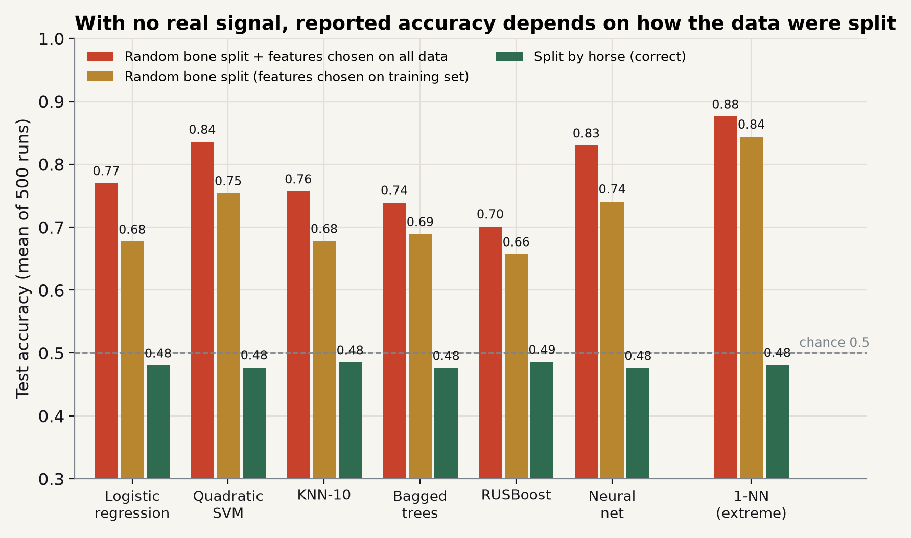
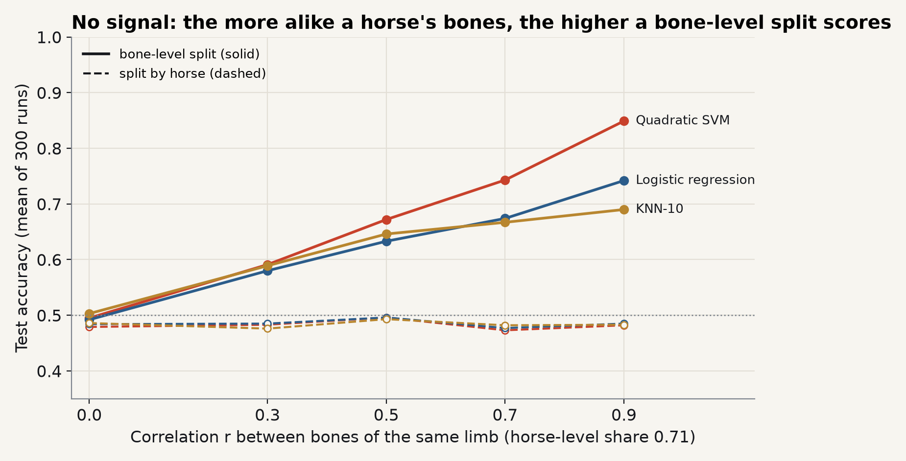
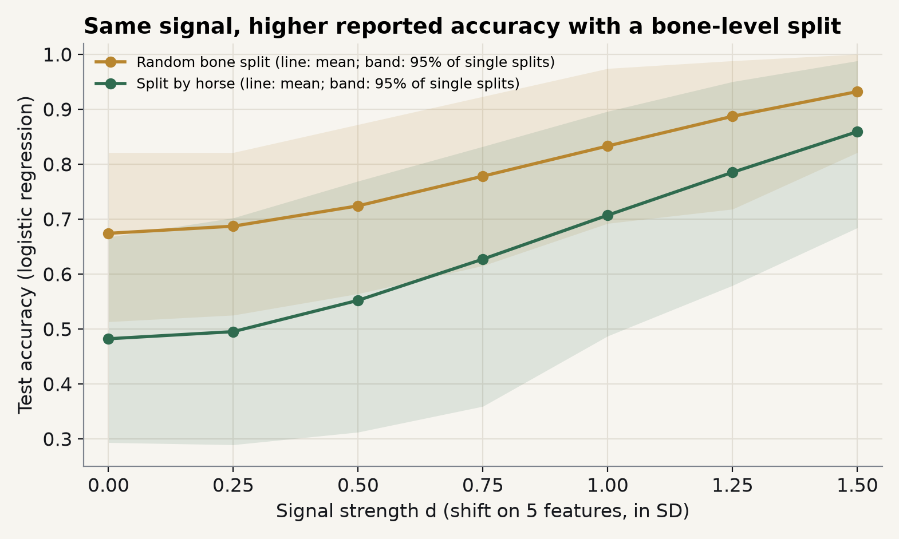

# Results

From `results/basran2022.json`: full suite, seed 20261102, Python 3.14.10, numpy 2.5.4, scikit-learn 1.9.1, imbalanced-learn 0.14.2. The run took 441 s on an AMD Ryzen 9 5900X (12 cores, 24 threads); the timed progress output is in `results/basran2022.log`. Accuracy is the mean over replicates; its Monte Carlo standard error is at most 0.005 in E1 and at most 0.007 elsewhere. Main setting unless stated: *r* = 0.7, 102 features, top 20 kept, 39 test bones.

The same seeds on Python 3.10, numpy 2.2.6 and scikit-learn 1.7.2 gave identical values to three decimals for E1 at *d* = 0 and for E6 at *d* = 0.

## E1: main comparison

**No signal (*d* = 0).** Every number above about 0.5 is an artefact.

| Model | Bone split, features on all data | Bone split, clean | Horse split, clean | Horse split, features on all data |
|---|---|---|---|---|
| Logistic regression | 0.770 | 0.677 | 0.480 | 0.687 |
| Quadratic SVM | 0.836 | 0.754 | 0.477 | 0.699 |
| KNN-10 | 0.757 | 0.678 | 0.485 | 0.675 |
| Bagged trees | 0.739 | 0.689 | 0.476 | 0.603 |
| RUSBoost | 0.701 | 0.657 | 0.486 | 0.580 |
| Neural net | 0.830 | 0.741 | 0.476 | 0.713 |
| 1-NN (extreme case) | 0.876 | 0.844 | 0.481 | 0.626 |

- Split by horse with clean preprocessing, all seven models score 0.48 (balanced accuracy 0.49–0.50, AUC 0.49–0.50), as they should with no signal.
- A random bone split alone lifts the paper's six models to 0.66–0.75.
- Selecting features on all 129 bones adds more: 0.70–0.84 with a bone split. Even with a horse split, selecting features before splitting reaches 0.58–0.71, so it is a second source of inflation, about as large as the first.

**Known signal (*d* = 1.0).**

| | Bone, all data | Bone, clean | Horse, clean | Horse, all data |
|---|---|---|---|---|
| Six paper models | 0.79–0.93 | 0.77–0.89 | 0.69–0.72 | 0.72–0.87 |
| 1-NN | 0.925 | 0.904 | 0.665 | 0.765 |

With a real but moderate signal, the correct pipeline reports about 0.70; a bone split with features chosen on all data reports up to 0.93.

## E2: within-limb correlation (no signal)

| *r* | Bone split: LR / SVM-Q / KNN-10 / 1-NN | Horse split: LR / SVM-Q / KNN-10 / 1-NN |
|---|---|---|
| 0 | 0.492 / 0.495 / 0.503 / 0.497 | 0.484 / 0.479 / 0.486 / 0.486 |
| 0.3 | 0.580 / 0.591 / 0.589 / 0.575 | 0.485 / 0.483 / 0.476 / 0.487 |
| 0.5 | 0.633 / 0.672 / 0.646 / 0.684 | 0.496 / 0.496 / 0.493 / 0.501 |
| 0.7 | 0.674 / 0.743 / 0.667 / 0.841 | 0.477 / 0.473 / 0.482 / 0.479 |
| 0.9 | 0.742 / 0.849 / 0.690 / 0.900 | 0.485 / 0.482 / 0.483 / 0.486 |

At *r* = 0, the negative control, the two splits agree within 0.02. The bone-split inflation grows with *r*; the horse split stays flat.

## E3: signal strength (logistic regression)

| *d* | Bone split: mean (95% of single splits) | Horse split: mean (95% of single splits) |
|---|---|---|
| 0 | 0.674 (0.51–0.82) | 0.482 (0.29–0.67) |
| 0.5 | 0.724 (0.56–0.87) | 0.552 (0.31–0.77) |
| 1.0 | 0.833 (0.69–0.97) | 0.707 (0.49–0.90) |
| 1.5 | 0.932 (0.82–1.00) | 0.859 (0.68–0.99) |

The gap narrows as the signal grows (0.19 at *d* = 0, 0.13 at 1.0, 0.07 at 1.5). A single 39-bone test set is noisy: at *d* = 1.0 a correctly split model can report anything from 0.49 to 0.90.

## E4: sensitivity (no signal)

| Variant | Bone split: LR / SVM-Q / KNN-10 / 1-NN | Horse split, range |
|---|---|---|
| Main analysis (*r* = 0.7, E2) | 0.674 / 0.743 / 0.667 / 0.841 | 0.47–0.48 |
| Missing bone on a one-limb horse | 0.682 / 0.748 / 0.677 / 0.839 | 0.48–0.49 |
| Limb-dominant correlation (*s* = 0.3) | 0.654 / 0.713 / 0.642 / 0.810 | 0.49–0.50 |
| Medial/lateral offset (SD 0.5) | 0.666 / 0.719 / 0.662 / 0.738 | 0.48–0.49 |

The conclusion does not depend on where the missing bone sits or how the correlation divides between horse and limb.

## E5: 10-fold cross-validation

Preprocessing inside the folds; accuracy and AUC on pooled out-of-fold predictions.

| | Bone folds (`KFold`): LR / SVM-Q / KNN-10 | Horse folds (`GroupKFold`): LR / SVM-Q / KNN-10 |
|---|---|---|
| *d* = 0, accuracy | 0.695 / 0.777 / 0.698 | 0.476 / 0.473 / 0.474 |
| *d* = 0, AUC | 0.746 / 0.851 / 0.776 | 0.453 / 0.466 / 0.457 |
| *d* = 1.0, accuracy | 0.850 / 0.902 / 0.839 | 0.721 / 0.735 / 0.714 |

Cross-validation does not remove the problem: folds built by bone inflate accuracy as much as a single bone split does. The AUC below 0.5 under horse folds probably comes from pooling scores of ten different fold models; this was not investigated further.

## E6: reporting the best configuration

Horse-grouped 10-fold CV, clean preprocessing, 6 models × *N* ∈ {3, 5, 10, 20} = 24 configurations.

| | Mean of 24 (95% range) | Best of 24 (95% range) |
|---|---|---|
| *d* = 0 | 0.485 (0.36–0.60) | 0.574 (0.47–0.71) |
| *d* = 1.0 | 0.765 (0.65–0.86) | 0.850 (0.75–0.94) |

Even with correct splitting, reporting the best of 24 configurations adds about 0.09. In Basran et al. (2022), the abstract's 0.754 is the mean of the 48 configurations in Table 4 and 0.903 is the highest of them; the two answer different questions.

One coincidence worth flagging: with no signal and a bone split, the quadratic SVM here scores 0.754, the same as the paper's mean. It shows only that accuracy alone cannot tell "learned the fracture signal" from "recognised the horse"; it is not evidence that the paper's number came from leakage, and the paper's evaluation procedure is not stated precisely enough to compare.

## Leak rate

Under a random 90/39 bone split, 82.6% of test bones have at least one bone from the same horse in training (case horses 70.3%, control horses 93.3%), and 69.8% have the other bone of the same limb in training. 20,000 simulated splits give 0.826, matching the closed form.
