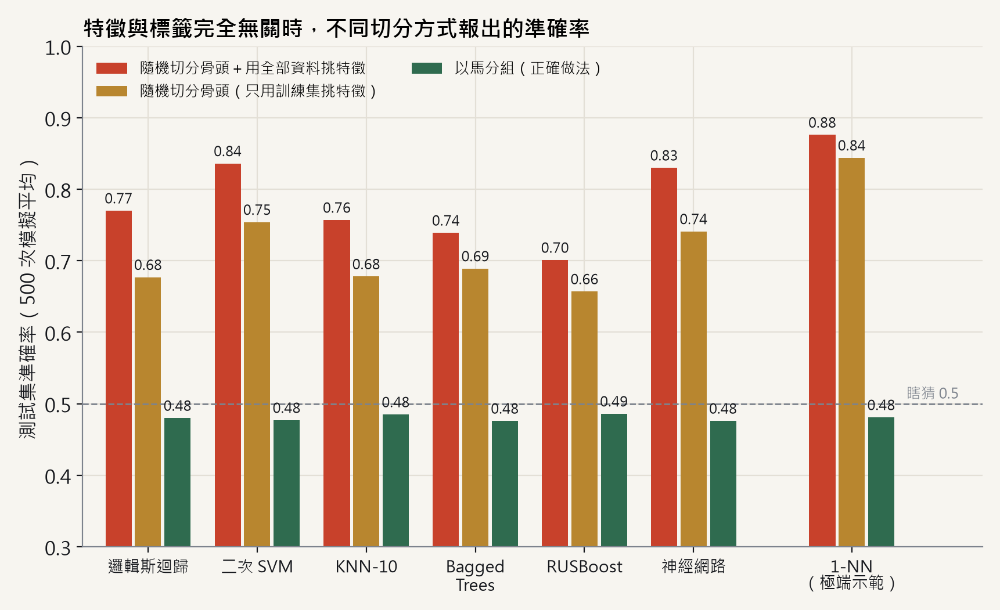
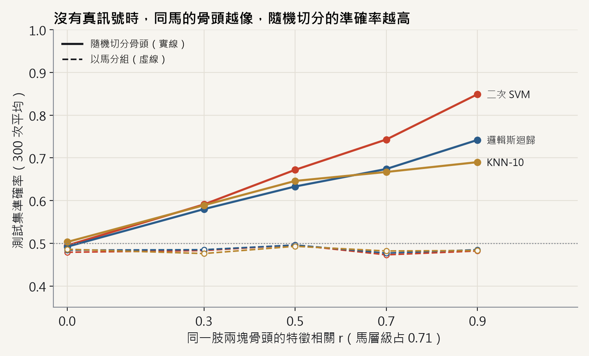
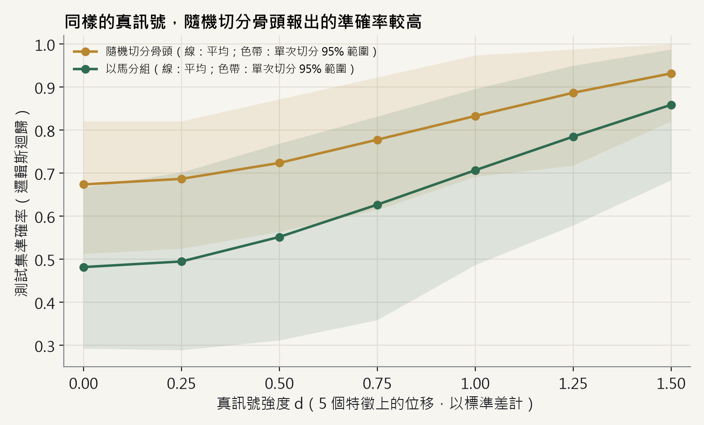

# 結果

數字取自 `results/basran2022.json`：完整實驗，種子 20261102，Python 3.14.10、numpy 2.5.4、scikit-learn 1.9.1、imbalanced-learn 0.14.2。在 AMD Ryzen 9 5900X（12 核 24 執行緒）上執行 441 秒，逐步的進度與時間記錄在 `results/basran2022.log`。準確率是各次重複的平均，蒙地卡羅標準誤在 E1 最多 0.005，其他實驗最多 0.007。除非另外註明，設定為 *r* = 0.7、102 個特徵取前 20 個、測試集 39 塊骨。

同樣的種子在 Python 3.10、numpy 2.2.6、scikit-learn 1.7.2 上，E1（*d* = 0）與 E6（*d* = 0）的數值到小數第三位完全相同。

## E1：主比較

**沒有真訊號（*d* = 0）。** 明顯高於 0.5 的數字都是假象。

| 模型 | 骨頭切分＋用全部資料挑特徵 | 骨頭切分（乾淨） | 以馬分組（乾淨） | 以馬分組＋用全部資料挑特徵 |
|---|---|---|---|---|
| 邏輯斯迴歸 | 0.770 | 0.677 | 0.480 | 0.687 |
| 二次 SVM | 0.836 | 0.754 | 0.477 | 0.699 |
| KNN-10 | 0.757 | 0.678 | 0.485 | 0.675 |
| Bagged Trees | 0.739 | 0.689 | 0.476 | 0.603 |
| RUSBoost | 0.701 | 0.657 | 0.486 | 0.580 |
| 神經網路 | 0.830 | 0.741 | 0.476 | 0.713 |
| 1-NN（極端示範） | 0.876 | 0.844 | 0.481 | 0.626 |

- 以馬分組、前處理只用訓練集時，七個模型都是 0.48（平衡準確率 0.49–0.50、AUC 0.49–0.50），符合沒有訊號的預期。
- 只要改成隨機切分骨頭，論文的六個模型就升到 0.66–0.75。
- 再用全部 129 塊骨挑特徵，骨頭切分會到 0.70–0.84。即使以馬分組，切分前挑特徵也會到 0.58–0.71，所以這是第二個高估來源，幅度和第一個差不多。

**已知訊號（*d* = 1.0）。**

| | 骨頭切分，全部資料 | 骨頭切分，乾淨 | 以馬分組，乾淨 | 以馬分組，全部資料 |
|---|---|---|---|---|
| 論文六個模型 | 0.79–0.93 | 0.77–0.89 | 0.69–0.72 | 0.72–0.87 |
| 1-NN | 0.925 | 0.904 | 0.665 | 0.765 |

訊號真實但中等時，正確流程報出約 0.70；骨頭切分加上用全部資料挑特徵，最高報出 0.93。

## E2：同肢相關（無訊號）

| *r* | 骨頭切分：LR／SVM-Q／KNN-10／1-NN | 以馬分組：LR／SVM-Q／KNN-10／1-NN |
|---|---|---|
| 0 | 0.492／0.495／0.503／0.497 | 0.484／0.479／0.486／0.486 |
| 0.3 | 0.580／0.591／0.589／0.575 | 0.485／0.483／0.476／0.487 |
| 0.5 | 0.633／0.672／0.646／0.684 | 0.496／0.496／0.493／0.501 |
| 0.7 | 0.674／0.743／0.667／0.841 | 0.477／0.473／0.482／0.479 |
| 0.9 | 0.742／0.849／0.690／0.900 | 0.485／0.482／0.483／0.486 |

*r* = 0 是陰性對照，兩種切分的差距在 0.02 以內。骨頭切分的高估隨 *r* 增加，以馬分組則維持不變。

## E3：訊號強度（邏輯斯迴歸）

| *d* | 骨頭切分：平均（單次切分 95% 範圍） | 以馬分組：平均（單次切分 95% 範圍） |
|---|---|---|
| 0 | 0.674（0.51–0.82） | 0.482（0.29–0.67） |
| 0.5 | 0.724（0.56–0.87） | 0.552（0.31–0.77） |
| 1.0 | 0.833（0.69–0.97） | 0.707（0.49–0.90） |
| 1.5 | 0.932（0.82–1.00） | 0.859（0.68–0.99） |

訊號越強，差距越小（*d* = 0 時 0.19、1.0 時 0.13、1.5 時 0.07）。單一 39 塊測試集的雜訊很大：*d* = 1.0 時，正確切分的模型可能報出 0.49 到 0.90 之間的任何數字。

## E4：敏感度分析（無訊號）

| 情境 | 骨頭切分：LR／SVM-Q／KNN-10／1-NN | 以馬分組範圍 |
|---|---|---|
| 主分析（*r* = 0.7，取自 E2） | 0.674／0.743／0.667／0.841 | 0.47–0.48 |
| 損毀骨放在單肢馬 | 0.682／0.748／0.677／0.839 | 0.48–0.49 |
| 相關以肢為主（*s* = 0.3） | 0.654／0.713／0.642／0.810 | 0.49–0.50 |
| 內外側骨系統差異（標準差 0.5） | 0.666／0.719／0.662／0.738 | 0.48–0.49 |

結論不受損毀骨放在哪匹馬、相關如何分配在馬與肢之間影響。

## E5：10 折交叉驗證

前處理都在折內；準確率與 AUC 以合併各折的預測計算。

| | 以骨分折（`KFold`）：LR／SVM-Q／KNN-10 | 以馬分折（`GroupKFold`）：LR／SVM-Q／KNN-10 |
|---|---|---|
| *d* = 0，準確率 | 0.695／0.777／0.698 | 0.476／0.473／0.474 |
| *d* = 0，AUC | 0.746／0.851／0.776 | 0.453／0.466／0.457 |
| *d* = 1.0，準確率 | 0.850／0.902／0.839 | 0.721／0.735／0.714 |

交叉驗證不會解決問題：以骨分折的高估和單次骨頭切分一樣大。以馬分折時 AUC 低於 0.5，可能是合併十個不同折模型的分數所致，本專案沒有再深入檢查。

## E6：只報最好的設定

以馬分組 10 折交叉驗證、前處理在折內，6 個模型 × *N* ∈ {3, 5, 10, 20} = 24 組設定。

| | 24 組平均（95% 範圍） | 24 組最高（95% 範圍） |
|---|---|---|
| *d* = 0 | 0.485（0.36–0.60） | 0.574（0.47–0.71） |
| *d* = 1.0 | 0.765（0.65–0.86） | 0.850（0.75–0.94） |

即使切分正確，只報 24 組中最高的一組也會多出約 0.09。Basran et al. (2022) 摘要的 0.754 是 Table 4 共 48 組設定的平均，0.903 是其中最高的一組，兩者回答的是不同問題。

有一個巧合需要說明：沒有訊號、隨機切分骨頭時，這裡的二次 SVM 得到 0.754，剛好等於論文的平均。這只表示單看準確率分不出「學到骨折訊號」和「認出同一匹馬」，不是論文數字來自洩漏的證據；論文的評估程序也沒有寫清楚到可以直接比較。

## 洩漏率

90／39 隨機切分骨頭時，82.6% 的測試骨在訓練集中至少有一塊同馬的骨頭（病例馬 70.3%、對照馬 93.3%），69.8% 的測試骨在訓練集中有同肢的另一塊骨。20,000 次模擬切分得到 0.826，與解析解相同。
